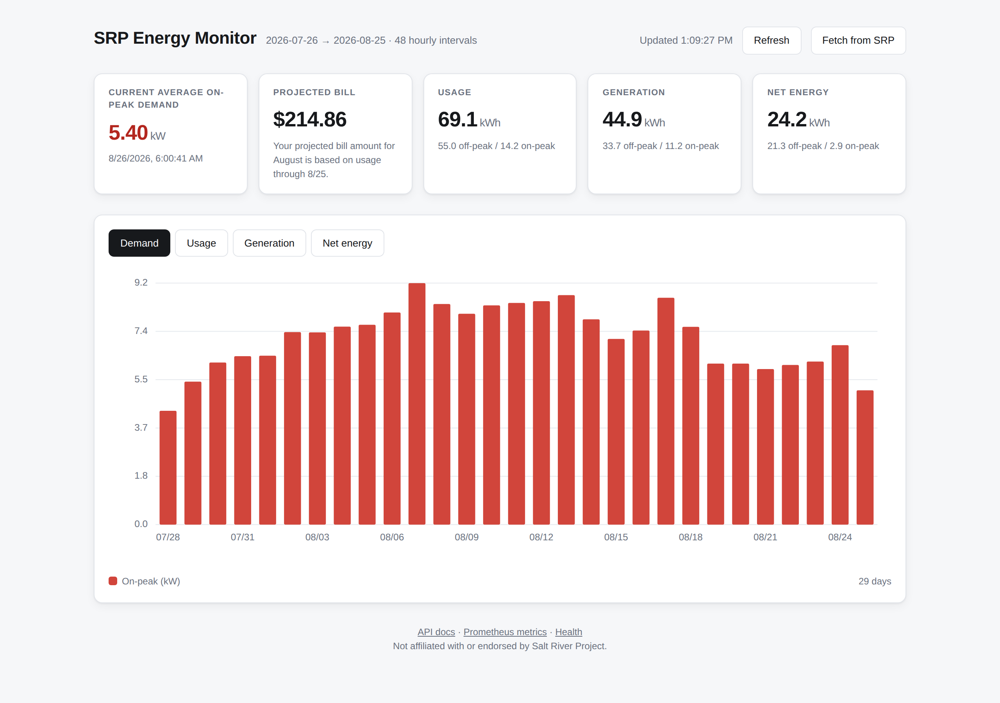
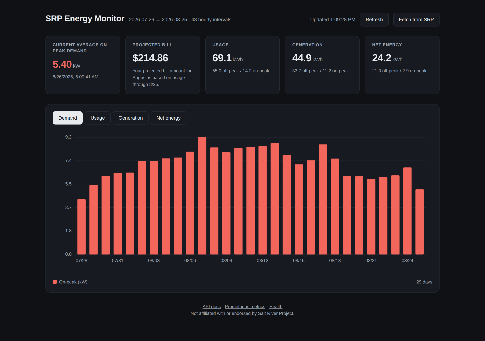

<div align="center">

# SRP Energy Monitor

**An unofficial API for your own Salt River Project electricity data.**

Salt River Project (SRP) is an electric utility in Arizona. Its **demand price plans** charge
for high on-peak power as well as energy used. The calculation depends on your plan: E-15
averages daily highest on-peak half-hours, while E-27 uses the cycle's highest half-hour.
This project retrieves SRP's own plan-labelled demand figure and your electricity history.

This project signs in to SRP as you, on a schedule, and hands your data back three ways:
a **web dashboard**, a **REST API with Prometheus metrics**, and a **Home Assistant integration**.

[](https://github.com/JeremyWhittaker/srp-energy-monitor/actions/workflows/ci.yml)
[](https://www.python.org/downloads/)
[](LICENSE)
[](https://github.com/astral-sh/ruff)
[](#3-the-home-assistant-integration)





<sub>The built-in dashboard, light and dark. No CDN, no JavaScript framework. Numbers are synthetic.</sub>

</div>

---

> [!IMPORTANT]
> This is not affiliated with, endorsed by, or supported by Salt River Project. It signs in with
> **your** credentials, reads **your own** account, and does nothing else.

## Contents

[Your worst half hour](#your-worst-half-hour) · [What is in this project](#what-is-in-this-project)
· [Quickstart](#quickstart) · [Home Assistant](#home-assistant) · [The collector](#the-collector)
· [The API](#the-api) · [Prometheus](#prometheus-and-grafana) · [Which plans charge for demand](#which-plans-charge-for-demand)
· [Python library](#as-a-python-library) · [How it works](#how-it-works) · [Limitations](#limitations)
· [FAQ](#faq) · [Related projects](#related-projects) · [Contributing](#contributing)

---

## Your worst half hour

Most electricity bills charge for **energy** — how many kilowatt-hours you used over the month.

SRP's demand plans add a second charge, for **demand**: average power over an on-peak interval,
measured in kilowatts (kW). The billing calculation is plan dependent. E-15 averages daily
highest 30-minute demands; E-27 uses the cycle's highest 30-minute demand. Other plans use
60-minute intervals. [SRP explains the difference](https://www.srpnet.com/price-plans/residential-electric/solar-demand-plans-savings).

The practical version: one July evening with the air conditioning, the oven, the dryer and the
car charger all running at once can add more to your bill than an entire ordinary day of use.
And you will not find out until the bill arrives.

SRP prints that kW number in a single card in My Account. It will text you when your *usage*
looks high, after the fact. It will not warn you that your *demand* is climbing, at a threshold
you picked, while you can still turn something off. It will not tell your thermostat either.

This project turns that number into something a computer can read — on a schedule, without you
opening a browser.

Not every SRP plan has a demand charge, and the ones that do **do not all measure the same
thing** — some average your daily worst moments, one takes the single worst moment of the whole
cycle. That distinction matters enough to have its own section:
[which plans charge for demand](#which-plans-charge-for-demand).

---

## What is in this project

Three parts, one repository, one story: **get your SRP data, keep it, and put it where you can
use it.**

```
                        ┌─────────────────────────┐
                        │   SRP My Account        │
                        │   (your login)          │
                        └───────────┬─────────────┘
                                    │
                 ┌──────────────────┴───────────────────┐
                 │                                      │
         1. THE COLLECTOR                    3. HOME ASSISTANT
         signs in on a schedule              talks to SRP by itself,
         stores history in SQLite            every 4 hours
                 │                                      │
                 ▼                                      ▼
         2. THE WEBSITE + API                  6 sensors, years of
         dashboard, JSON, Prometheus           charted history, and
                 │                             automations you write
                 ▼
         Grafana, scripts, anything
         that speaks HTTP
```

**The three parts are independent.** Pick one, pick all three. In particular, the Home Assistant
integration talks to SRP directly — it does not read the database and it does not call the API,
so you do not need the collector or the website running for it to work.

### 1. The collector

Signs in to your SRP account, pulls down your daily usage, solar generation, net energy, demand
and SRP's own bill projection, and writes them into a SQLite file on your disk. Run it by hand,
or once a day from a timer. Re-running it is safe: it corrects existing rows instead of
duplicating them, which matters because SRP restates recent days as meter readings settle.

> **You need this if** you want your own copy of the history, on your own machine, that keeps
> growing after SRP stops showing it to you.

### 2. The website and API

A dashboard you open in a browser, plus the same data as JSON over HTTP and as Prometheus
metrics. There is an OpenAPI page at `/docs` you can click around. The dashboard has no CDN
links and no framework — it is one HTML file.

> **You need this if** you want to look at the numbers, chart them in Grafana, or wire them into
> anything that can make an HTTP request.

### 3. The Home Assistant integration

A custom integration that lives in this repo and installs into Home Assistant. It creates six
sensors and back-fills years of hourly history the first time it runs, so the charts have
something in them immediately. It signs in to SRP itself, every four hours.

> **You need this if** you run Home Assistant and want demand, usage and your projected bill
> alongside everything else in your house — with automations, alerts and the Energy dashboard.

### What the data actually is

| Series | What SRP reports | Unit |
|---|---|---|
| `usage` | SRP's consumption series, split off-peak / on-peak | kWh |
| `generation` | SRP's generation series, split off-peak / on-peak; physical coverage is unverified | kWh |
| `net` | Net energy — negative when you export more than you draw | kWh |
| `demand` | Your daily on-peak demand | kW |

Every daily row also carries that day's **high and low temperature**, which SRP includes in its
own exports and which explains most usage spikes on its own.

Two more values are recorded as time series so you can watch them climb through the month: SRP's
**projected bill amount**, and the **headline demand figure** for the cycle in progress.

### What that looks like

Now that you know what the pieces are, here is the payoff — the demand figure, from part 2's API,
as JSON:

```console
$ curl -s localhost:8000/api/v1/demand
{
  "observed_at": "2026-08-26T06:00:41",
  "demand_kw": 5.4,
  "unit": "kW",
  "label": "Current Average On-Peak Demand",
  "is_average": true,
  "source": ".srp-red-text strong"
}
```

`label` and `is_average` are SRP's own caption for the number, stored next to it rather than
guessed at. [Why that matters](#which-plans-charge-for-demand).

---

## Quickstart

Needs **Python 3.10+**. Not on PyPI yet, so install from a checkout:

```bash
git clone https://github.com/JeremyWhittaker/srp-energy-monitor.git
cd srp-energy-monitor

python3 -m venv .venv && source .venv/bin/activate
pip install -e '.[all]'
playwright install chromium        # the browser collector needs a real browser

cp .env.example .env
$EDITOR .env                       # set SRP_USERNAME and SRP_PASSWORD

srp-energy-monitor fetch           # collect today's data
srp-energy-monitor serve           # dashboard at http://127.0.0.1:8000
```

That is the whole thing. Every setting is listed in
**[docs/CONFIGURATION.md](docs/CONFIGURATION.md)**.

Want years of history straight away, with no browser at all? Add your account number to `.env`
as `SRP_ACCOUNT_ID` (nine digits, no dashes) and run:

```bash
srp-energy-monitor backfill
```

**Only want Home Assistant?** Skip the install steps above and go to
**[docs/HOME-ASSISTANT.md](docs/HOME-ASSISTANT.md)**. You still need the files — the integration
is a folder in this repository that you copy into Home Assistant, so clone the repo or download
its ZIP from GitHub — but nothing here has to be installed, configured or left running. No
virtualenv, no `.env`, no database, no server.

> [!WARNING]
> **Multi-factor authentication is not supported.** If your SRP account has MFA turned on,
> nothing here can log in — not the collector, not the Home Assistant integration. There is no
> workaround.

`.env` is gitignored. Your password is read from the environment, never written to the database,
never logged, and never returned by the API. Your *username* does appear in the log at INFO on
each login, so scrub it before pasting a log into a bug report.

---

## Home Assistant

**Full guide: [docs/HOME-ASSISTANT.md](docs/HOME-ASSISTANT.md)** — written for someone who runs
Home Assistant and pays an SRP bill, not for a programmer.

The short version. Copy `custom_components/srp_energy_monitor/` into your Home Assistant's
`config/custom_components/`, restart Home Assistant, then add it from **Settings → Devices &
Services → Add Integration**. It asks for your account number, username and password.

It talks to SRP directly over SRP's JSON API. That means no browser on the Home Assistant box,
and `"requirements": []` in the manifest — nothing is installed at setup time, so nothing can
fail to build a wheel on a Raspberry Pi.

### Sensors

| Sensor | Unit | What it is |
|---|---|---|
| Current demand | kW | What SRP prints for the cycle in progress — an average on E-15/E-16, a maximum on E-27. The `is_average` attribute says which. |
| Billed cycle peak | kW | The single highest on-peak half hour of the cycle, with the timestamp it happened |
| Bill projection | USD | SRP's own projection for this cycle |
| Demand audit | — | Whether SRP's completed daily maxima agree with its already fetched half-hour data; coverage and caveats are in the attributes |
| Daily consumption | kWh | SRP's consumption series for the most recent settled day |
| Daily on-peak generation | kWh | The most recent settled day, **on-peak only** — see the warning below |
| Daily net energy | kWh | The most recent settled day |

The demand audit is enabled only by an explicit integration option
`demand_audit_plan: E15`. Without that binding, or with another plan, its state is `unsupported`:
SRP's average-demand flag also covers E-16 and does not prove E-15 enrollment. The binding
records the configured household policy; it does not independently confirm the account's plan.

The audit reuses the normal four-hour utility refresh and checks at most seven completed Arizona
days. It checks settled reports, rather than providing a real-time meter warning.
Every expected E-15 peak half-hour must be present: 12 in summer or 16 in winter, excluding
weekends and SRP's six holidays. Real zero-demand weekdays count. Missing, conflicting,
nonfinite, negative, wrong-width or incompatible-unit readings produce `incomplete`; a complete
comparison is `matches` or `mismatch`, with a 0.05 kW daily-rounding allowance. These are two
related utility reports, not independent meter calibration. Raw demand timestamps use the
verified start-label contract; the separate cycle-maximum occurrence field is not substituted.

Attributes retain each day's coverage, both maxima, the exact earliest winning half-hour and
tie count, latest complete day, source caveats and a canonical content checksum. The checksum
ignores refresh time and response order, but changes when a retained source value changes.
Derived historical cycle means require every eligible daily value and explicitly retain
unverified historical plan identity. Only the displayed replay days were checked against
intervals. Actual invoice demand-charge dollars are not collected: `billed_cost_verified` is
always false. Existing cycle-maximum and bill-projection sensors keep their separate meanings.

### Years of history, back-filled on day one

It also writes **long-term statistics**: hourly kWh for SRP's consumption, generation and net
series, plus supplied on-peak demand intervals stored as an hourly mean with a min and a max.
Chart the **max** column to keep the highest supplied interval within each hour. That chart is
different from the average daily maxima used to bill E-15/E-16.

On the account this was built against, the first backfill reached **2024-07-29** for energy and
**2025-05-04** for generation and demand — everything SRP still retains.

Later refreshes revisit the **seven most recent completed Arizona days**, plus any collection
gap. Revised hourly energy replaces the previous value, and cumulative totals are rebuilt from
a known preceding total through every affected later hour. Repeating an unchanged import does
not add its final hour again. Missing response hours retain existing readings; ambiguous
duplicates, missing baselines, unfilled gaps and future/incomplete-day rows skip that series
with a diagnostic instead of manufacturing energy.

Version 1.2.3 excludes SRP holidays from reconstructed average demand in both parsers, while preserving ordinary zero-demand weekdays. It also clarifies portal-series labels without changing their IDs or rewriting statistics. The daily-denominator rule follows the published tariff; a holiday-containing bill remains a separate verification gate.

Version 1.2.2 corrects the earlier Home Assistant importer, which could retain outdated revised
hours and count its final hour repeatedly in cumulative statistics. The normal seven-day replay
cannot repair older errors or prove its preceding total was historically correct. Back up the
affected statistics and use a controlled targeted backfill when older history needs repair;
do not clear or recreate every statistic. See [statistics recovery](docs/HOME-ASSISTANT.md#utility-restatements-and-existing-history).

Only the on-peak leg of demand is stored. SRP publishes an off-peak figure too, and on a solar
account it is far larger — 25.3 kW against a 12.7 kW billed peak over one measured cycle — so
keeping both would draw a chart that looks like demand while showing a number no bill has ever
contained.

> [!IMPORTANT]
> **SRP generation is a portal series, not a verified whole-roof production meter.** The daily
> sensor deliberately keeps only the daily list's **on-peak** field. Its existing name and ID
> stay unchanged. Daily off-peak generation is not always zero: November 2026 responses contain
> nonzero values. The `energy_generation` statistic sums the hourly portal generation series.
> On 2026-08-27, the daily on-peak figure was **21 kWh**, while the hourly series summed to
> **84.5 kWh**. That difference does not prove either figure measures all solar panels.
> Reconciliation with inverter and panel-monitor totals remains open; do not add this series to
> those totals as if it were another independent array.

A three-view dashboard built against these sensors is in
[`docs/ha-dashboard.yaml`](docs/ha-dashboard.yaml). Paste it into a dashboard's raw
configuration editor and replace the account number.

> [!NOTE]
> This is **not** Home Assistant's built-in `srp_energy` integration. That one reports a single
> kWh total and cannot see demand at all. This uses a different name internally, so the two can
> be installed side by side.

### Fallback: point REST sensors at the API instead

If you would rather run the server and keep Home Assistant thin, the built-in REST platform works
against any host running `srp-energy-monitor serve`. This is the fallback, not the main path —
you get two sensors and no history backfill, and you have to keep the server running.

Use the server's address, not `127.0.0.1`, unless Home Assistant is on the same machine:

```yaml
sensor:
  - platform: rest
    name: SRP demand
    resource: http://YOUR-HOST:8000/api/v1/demand
    value_template: "{{ value_json.demand_kw }}"
    unit_of_measurement: kW
    device_class: power
    state_class: measurement
    json_attributes: [label, is_average, observed_at]
    scan_interval: 3600

  - platform: rest
    name: SRP billed cycle peak
    resource: http://YOUR-HOST:8000/api/v1/cycle-peaks?limit=1
    value_template: "{{ value_json.peaks[0].on_peak_high_demand_kw }}"
    unit_of_measurement: kW
    device_class: power
    state_class: measurement
    scan_interval: 3600
```

---

## The collector

Seven commands. That is the whole CLI:

```bash
srp-energy-monitor fetch          # all four series + the demand figure + bill projection
srp-energy-monitor hourly         # hourly interval data for a date range
srp-energy-monitor show           # print what is in the database
srp-energy-monitor serve          # dashboard + REST API
srp-energy-monitor export --format json --series demand
srp-energy-monitor import ./old-downloads    # replay CSVs you already downloaded
srp-energy-monitor backfill       # years of history from the JSON API, no browser

srp-energy-monitor fetch --no-demand         # CSVs only, skip the live numbers
srp-energy-monitor fetch --show-browser      # watch it work when selectors break
```

`--env-file`, `--database` and `--log-level` are global flags, so they go **before** the
subcommand: `srp-energy-monitor --database /tmp/other.db show`.

A fetch looks like this:

```console
$ srp-energy-monitor fetch
2026-08-26 06:00:32 INFO    srp_energy.client: logging in to SRP as example
2026-08-26 06:00:39 INFO    srp_energy.client: SRP login successful
2026-08-26 06:00:41 INFO    srp_energy.client: Current Average On-Peak Demand: 5.40 kW (via .srp-red-text strong)
2026-08-26 06:01:04 INFO    srp_energy.service: fetch complete: 124 readings across ['usage', 'generation', 'net', 'demand']
Current Average On-Peak Demand: 5.40 kW
Projected bill: $214.86  (Your projected bill amount for August is based on usage through 8/25.)
Stored 124 readings across 4 series: usage, generation, net, demand
```

And `show` prints the state of the database:

```console
$ srp-energy-monitor show --days 2
Current Average On-Peak Demand: 5.40 kW  (2026-08-26T06:00:41)

  demand        31 days  2026-07-26 .. 2026-08-25
  generation    31 days  2026-07-26 .. 2026-08-25
  net           31 days  2026-07-26 .. 2026-08-25
  usage         31 days  2026-07-26 .. 2026-08-25
Projected bill: $214.86
  Your projected bill amount for August is based on usage through 8/25.
  hourly        48 intervals  2026-08-24T00:00 .. 2026-08-25T23:00

date         series       off-peak   on-peak  high   low
2026-08-25   demand              -      5.12   104    79
2026-08-25   generation      33.67     11.24   104    79
2026-08-25   net             21.28      2.93   104    79
2026-08-25   usage           54.95     14.17   104    79
```

### Hourly detail

SRP's Hourly/Interval view accepts an explicit date range, so history can be pulled a window at
a time:

```bash
srp-energy-monitor hourly --days 3                      # last 3 days, usage
srp-energy-monitor hourly --start 2026-08-01 --end 2026-08-25
srp-energy-monitor hourly --days 2 --series usage --series net --show
srp-energy-monitor hourly --days 1 \
    --series usage --series generation --series net --series demand
```

Each series has to be exported separately, because **SRP's hourly export follows whichever chart
is on screen**. Without picking one you quietly get net energy filed under a name that implies
something else. The default is `usage` alone, so pass `--series` for anything more.

**Demand intervals are half-hourly and in kW**, not hourly kWh — that is the granularity demand
charges are actually assessed on. A day of demand is 48 rows; the three energy series are 24.

Timestamps are Arizona local time and need no offset, because Arizona does not observe daylight
saving. There are no repeated or missing hours to untangle.

### Running it unattended

SRP settles the previous day overnight, so collecting once a day is plenty. The repo ships three
systemd **user** units — a daily fetch, its timer, and the web server — so that neither the
collector nor the dashboard depends on a terminal you left open:

```bash
mkdir -p ~/.config/systemd/user
cp deploy/srp-fetch.service deploy/srp-fetch.timer deploy/srp-web.service ~/.config/systemd/user/
$EDITOR ~/.config/systemd/user/srp-fetch.service   # point it at your checkout
$EDITOR ~/.config/systemd/user/srp-web.service     # likewise

systemctl --user daemon-reload
systemctl --user enable --now srp-fetch.timer      # collect daily at 07:30, with jitter
systemctl --user enable --now srp-web.service      # dashboard + API on 127.0.0.1:8000
loginctl enable-linger "$USER"                     # or they only run while you are logged in
```

Both `.service` files run out of `.venv/bin/` in the checkout, so that virtualenv has to exist
with the right extra in it (`.[api]` for the web server, `.[scrape]` plus
`playwright install chromium` for the fetch) — otherwise the units restart in a loop against a
binary that is not there.

**[deploy/README.md](deploy/README.md)** covers all of that: what each unit does, the
prerequisites, why `loginctl enable-linger` matters and when it needs `sudo`, and how to check
that any of it is working.

Prefer cron?

```cron
30 7 * * *  cd /opt/srp-energy-monitor && .venv/bin/srp-energy-monitor fetch >> /var/log/srp-fetch.log 2>&1
```

---

## The API

`srp-energy-monitor serve` starts the dashboard and the API together, and puts clickable OpenAPI
docs at **`/docs`**. To keep it running without a terminal, install `deploy/srp-web.service` —
see **[deploy/README.md](deploy/README.md)**.

| Endpoint | Returns |
|---|---|
| `GET /api/v1/demand` | Latest bill-cycle demand figure, with SRP's own caption |
| `GET /api/v1/demand/history?days=30` | Demand observations over time |
| `GET /api/v1/cycle-peaks?limit=24` | The figure each billing cycle was actually charged on |
| `GET /api/v1/bill-projection` | SRP's projected bill for this cycle |
| `GET /api/v1/bill-projection/history?days=30` | Projection over time |
| `GET /api/v1/readings?series=&start=&end=` | Daily readings, filterable |
| `GET /api/v1/intervals?series=&start=&end=` | Hourly and half-hourly interval readings |
| `GET /api/v1/series/{series}?days=30` | One series, shaped for charting |
| `GET /api/v1/summary` | Row counts and date coverage |
| `POST /api/v1/fetch` | Collect from SRP right now |
| `GET /health` | Liveness and coverage |
| `GET /metrics` | Prometheus exposition |
| `GET /` | Dashboard |

```console
$ curl -s 'localhost:8000/api/v1/readings?series=demand&start=2026-08-01' | jq '.readings[-1]'
{
  "series": "demand",
  "usage_date": "2026-08-25",
  "meter_read_date": "2026-08-26",
  "off_peak": null,
  "on_peak": 5.12,
  "high_temp_f": 104.0,
  "low_temp_f": 79.0,
  "unit": "kW",
  "total": null
}
```

> [!CAUTION]
> **The API has no authentication.** It listens on `127.0.0.1` by default for that reason. If you
> expose it, put it behind a reverse proxy, a VPN or a private overlay network. It will hand your
> full usage history to anyone who asks, and interval data is an excellent occupancy sensor.
> `/health` also reports your database path. See [SECURITY.md](SECURITY.md).

## Prometheus and Grafana

Point a scrape job at `/metrics` and the data lands in Grafana with no glue code:

```yaml
scrape_configs:
  - job_name: srp
    scrape_interval: 15m
    static_configs:
      - targets: ['localhost:8000']
```

```prometheus
srp_current_demand_kw{label="Current Average On-Peak Demand",is_average="true"}  5.4
srp_current_demand_observed_timestamp_seconds                                   1787749241
srp_projected_bill_dollars                                                      214.86
srp_daily_on_peak_demand_kw                                                     5.12
srp_daily_energy_kwh{series="usage",period="on_peak"}                           14.17
srp_daily_reading_timestamp_seconds{series="usage"}                             1787641200
srp_stored_readings{series="usage"}                                             31
```

The date is deliberately **not** a Prometheus label. Prometheus identifies a series by its label
set, so `date="…"` would mint a brand new series every day that lived 24 hours and that no range
query could span. The date is published as `srp_daily_reading_timestamp_seconds` instead — which
is also how you alert on the data going stale:

```yaml
- alert: SRPDataStale
  expr: time() - srp_daily_reading_timestamp_seconds{series="usage"} > 172800
  annotations:
    summary: "SRP usage data has not advanced in 2 days — the collector may be broken"
```

The `label` and `is_average` labels carry SRP's own caption, so an alert can **assert** which
quantity it is reading instead of assuming:

```yaml
- alert: SRPPeakDemandClimbing
  expr: srp_current_demand_kw{is_average="false"} > 12
  for: 1h
  annotations:
    summary: "On-peak demand is {{ $value }} kW and setting this cycle's charge"
```

---

## Which plans charge for demand

Read this before you alert on anything. As of SRP's November 2025 price plan changes:

| Plan | Name | Demand charge | What it measures |
|---|---|---|---|
| **E-16** | Manage Demand 5–10 p.m. and Save | Yes | The **average** of each day's worst **60-minute** on-peak stretch |
| **E-15** | Average Demand (legacy, solar) | Yes | The **average** of each day's worst **30-minute** on-peak stretch |
| **E-27** | Customer Generation (legacy, solar) | Yes | The single **worst 30 minutes** in the whole cycle |
| E-28 | Conserve 6–9 p.m. and Save | No | — |
| E-13 / E-14 | Time-of-Use Export / EV Export (legacy, solar) | No | — |
| E-21 (EZ-3) / E-23 (Basic) / E-24 (M-Power) / E-26 (TOU) | | No | — |

E-27 is a **maximum**. E-15 and E-16 are **averages**. Report one as the other and you have
misstated the number that drives the charge. **E-16 is open to every residential customer, solar
or not**, so a demand charge is no longer a solar owner's problem.

The JSON average uses daily on-peak maxima on weekdays, excluding SRP's six holidays:
observed New Year's Day, Memorial Day, observed Independence Day, Labor Day, Thanksgiving Day
and observed Christmas Day. Saturday fixed-date holidays are observed Friday; Sunday holidays
are observed Monday, including New Year's Day observed on the preceding December 31.
Ordinary zero-demand weekdays still count; MLK Day and Black Friday are not SRP holidays.
This denominator is inferred from the [2026 ratebook](https://www.srpnet.com/assets/srpnet/pdf/price-plans/FY26/TCA%20Ratebooks/2025-Ratebook-with-2026-TCA-with-cover.pdf)
(E-15 pp. 13–14, 17; E-16 pp. 20, 24). A holiday-containing billing cycle has not yet been
reconciled. The earlier 5.62 kW calculation versus 5.60 kW displayed covered a cycle without
SRP holidays and supports only the ordinary-weekday calculation and its rounding tolerance.

Demand records include a caption and an `is_average` attribute so consumers can distinguish
the quantities:

```json
{ "demand_kw": 5.4, "label": "Current Average On-Peak Demand", "is_average": true }
```

**Check `label` or `is_average` before you alert on it.** During development, reading an average
as if it were a peak understated the real maximum by more than 2× — 5.4 kW against an actual
12.7 kW.

The browser path reads the caption from SRP's page; the JSON path uses its `isAverageDemandRate`
flag and reconstructs an average when needed. If the browser cannot read a caption, it retains
the value with a null `label` and logs a warning. Check the plan rather than assuming a peak.

---

## As a Python library

Parsing and storage have **no browser dependency**, so you can point them at CSVs you downloaded
by hand:

```python
from srp_energy import Series, Store, parse_file, parse_hourly_file

readings = parse_file("srp_demand_20260826_060041.csv", Series.DEMAND)
worst = max(readings, key=lambda r: r.on_peak or 0)
print(f"Worst day: {worst.usage_date} at {worst.on_peak} kW ({worst.high_temp_f}°F)")

store = Store("./data/srp.db")
store.upsert_readings(readings)

# Hourly exports parse the same way; demand is half-hourly and in kW.
store.upsert_intervals(parse_hourly_file("srp_hourly_usage_20260825_20260826.csv"))

# And read it all back with no browser anywhere in sight.
print(store.latest_demand(), store.latest_bill_projection())
```

---

## How it works

```
  SRP My Account  ──►  client.py   ──►  parser.py  ──►  storage.py  ──►  api.py  ──►  your tools
  (Playwright)         sign in +        CSV → typed     SQLite           REST +        Grafana,
                       CSV export       readings        (upsert)         Prometheus    scripts

  SRP JSON API    ──►  jsonapi.py  ──────────┘          (Home Assistant uses the same
  (no browser)         backfill                          JSON contract, on its own)
```

The load-bearing decision is that **only `client.py` touches a browser**. Parsing, storage, the
CLI and the API all work on saved CSVs. So when SRP changes their markup — and they will — the
collector breaks while everything else keeps serving the history you already have. Every selector
is a cascade with fallbacks rather than one brittle string, for the same reason.

| Path | Role |
|---|---|
| `srp_energy/client.py` | Playwright login, live scrapes, CSV export |
| `srp_energy/jsonapi.py` | Browser-free client for SRP's private JSON API |
| `srp_energy/parser.py` | SRP CSV → typed readings (pure, no I/O) |
| `srp_energy/storage.py` | SQLite schema and queries |
| `srp_energy/service.py` | Wires collect → parse → store |
| `srp_energy/api.py` | FastAPI app, Prometheus rendering |
| `srp_energy/cli.py` | Command line entry points |
| `srp_energy/models.py` | Typed records: readings, intervals, demand, projection |
| `srp_energy/config.py` | Environment and `.env` settings |
| `srp_energy/__init__.py` | Public library surface (models, parsers, `Store`) |
| `srp_energy/web/dashboard.html` | The dashboard, one file, no CDN |
| `custom_components/srp_energy_monitor/` | The Home Assistant integration |
| `deploy/` | systemd user units for the daily collection **and the web server** — see [deploy/README.md](deploy/README.md) |
| `docs/` | [Home Assistant](docs/HOME-ASSISTANT.md), [configuration](docs/CONFIGURATION.md), [troubleshooting](docs/TROUBLESHOOTING.md) |
| `CLAUDE.md` | Handoff notes: the traps, and why the code is shaped this way |

---

## Limitations

Stated plainly, because finding these out the hard way is worse.

- **Not real-time.** SRP publishes yesterday's settled data, one day behind. This is a
  billing-data tool, not a live power monitor. Nothing here can show you what the house is
  drawing right now.
- **No MFA support.** If your SRP account has multi-factor authentication turned on, nothing
  here can log in, and there is no workaround.
- **Unofficial.** SRP publishes no *documented* API and supports none of this. The JSON endpoints
  behind the portal are private and unversioned; the portal's markup is not a contract either. It
  can break the day they change their site, with no notice and no deprecation window.
- **Cloudflare guards the portal.** A default Playwright browser gets an "Access Denied / Ray ID"
  page before SRP serves any markup, so the collector presents a realistic desktop fingerprint
  (real user agent, 1440×900 viewport, `America/Phoenix` timezone, no `navigator.webdriver`
  flag). That is presentation, not evasion of an access control — it still signs in with your own
  credentials to read your own data. If Cloudflare tightens further, this breaks first.
- **The headline demand figure means different things on different plans.** See
  [above](#which-plans-charge-for-demand) — check `label`.
- **Daily exports have no date-range control.** The four daily series give you whatever window
  the portal shows, usually the last ~31 days. Three ways further back: the *hourly* view takes
  an explicit range, old exports replay through `srp-energy-monitor import`, and
  `srp-energy-monitor backfill` pulls the account's whole retained daily history — **more than
  800 days** on the account this was built against — in a single JSON call.
- **Hourly requests are chunked.** SRP renders every interval in the window before it will
  export, so a multi-month request times out. Long ranges are split into 31-day windows
  automatically.
- **One account, one meter.** If your login has several, the collector takes whichever the portal
  defaults to.
- **Scraping is fragile by nature.** When collection starts failing, run
  `srp-energy-monitor fetch --show-browser` to watch it happen, then update the selector cascades
  in `client.py`. See **[docs/TROUBLESHOOTING.md](docs/TROUBLESHOOTING.md)**; for Home Assistant
  specifically, see [docs/HOME-ASSISTANT.md](docs/HOME-ASSISTANT.md).

## FAQ

<details>
<summary><b>Is this allowed? Will SRP shut my account down?</b></summary>

It signs in with your own credentials and reads your own data, once a day — the same thing you
would do in a browser. It is not a bulk scraper and it never touches anyone else's account.
That said, SRP's terms are between you and SRP, this is unaffiliated software, and you run it at
your own risk. Do not hammer it; once a day is genuinely enough.
</details>

<details>
<summary><b>Why not use SRP's Green Button / data download?</b></summary>

Because that is a file you download by hand, on a page, when you remember to. This is the same
data on a schedule, in a database, behind an API — plus the demand figure and the bill projection
that the download does not include.
</details>

<details>
<summary><b>Which SRP plans have a demand charge?</b></summary>

**E-16**, **E-15** and **E-27** do. **E-28**, **E-13**, **E-14**, **E-21/EZ-3**, **E-23/Basic**,
**E-24/M-Power** and **E-26** do not. The [table above](#which-plans-charge-for-demand) says what
each one measures.

Check your own bill. This is a summary of SRP's published tariffs, not advice, and SRP changes
them — E-16 only opened to all residential customers in November 2025.
</details>

<details>
<summary><b>Do I need solar for this to be useful?</b></summary>

No — and since E-16 opened demand charges to every residential customer, that is truer than it
used to be. `usage` and `demand` are the point on a demand plan, panels or not. `generation` and
`net` will simply be empty. Development happened on an account *with* solar, so if the portal
behaves differently without it, please
[open an issue](https://github.com/JeremyWhittaker/srp-energy-monitor/issues) — that is a
genuinely useful report.
</details>

<details>
<summary><b>Does it work for APS?</b></summary>

No. APS is a different utility with a different portal. The parsing and storage layers are
generic enough to reuse, but the collector is SRP-specific.
</details>

<details>
<summary><b>Where does my data go?</b></summary>

A SQLite file on your disk, and nowhere else. There is no telemetry and no cloud, and no network
traffic other than to SRP. The Home Assistant integration stores its data inside Home Assistant's
own database, likewise on your machine. See [SECURITY.md](SECURITY.md).
</details>

<details>
<summary><b>Can I run it in Docker?</b></summary>

There is no image yet. Playwright needs a browser inside the container, so it is real work rather
than a three-line Dockerfile. It is on the
[wanted list](CONTRIBUTING.md#things-that-would-genuinely-help).
</details>

## Related projects

> Not to be confused with the [`srpenergy`](https://pypi.org/project/srpenergy/) PyPI package or
> Home Assistant's built-in `srp_energy` integration. Different projects, similar names.

| Project | Returns | Browser? | Demand kW? |
|---|---|---|---|
| [srpenergy](https://github.com/lamoreauxlab/srpenergy-api-client-python) | Hourly kWh and cost | No | **No** |
| [HA `srp_energy`](https://www.home-assistant.io/integrations/srp_energy/) (built in) | Consumption and cost statistics | No | **No** |
| [SRPNET-api](https://github.com/Spencer-Sawyer/SRPNET-api) | Daily/hourly usage, rate code | No | **No** |
| SRP's own portal / Green Button | Manual CSV download, by hand, per chart | — | **No** |
| **This** | Demand kW, billed cycle peak, bill projection, usage, generation, net, temperature | Optional | **Yes** |

Every other client returns kWh and dollars. None exposes the kW demand figure or the bill
projection — which, on E-15/E-16/E-27, is the number that actually moves your bill.

The honest trade: **they need only Python, and so does this unless you want the browser.** The
JSON backend is stdlib-only, and installing this package with no extras pulls in nothing at all;
Chromium is needed only for `fetch`. If you just want a tiny dependency that reads hourly kWh in
a script, `srpenergy` is well maintained and a better fit. If you want the demand number, this is
currently the only option.

### Two backends, and why both exist

**`fetch`** drives the portal with Playwright and consumes the **CSV exports SRP itself offers
you** — a contract SRP publishes to its own customers.

**`backfill`** uses the private JSON API at `myaccount.srpnet.com/myaccountapi/api/...` — the
same undocumented, unversioned endpoints `srpenergy` calls — with no browser at all. The Home
Assistant integration speaks this one.

The JSON API can do everything the browser can: `isAverageDemandRate` states which quantity your
plan bills, `payments/billprojection` returns the projection as a field, and `demandList` carries
48 half-hourly kW readings a day that no other public client parses. The billed demand charge
comes out exactly — `max(onPeakDemand)` over a cycle matched SRP's own figure to the interval,
12.7 kW in the half hour ending 2026-08-18 20:00.

So the reason to keep both is not capability, it is **failure mode**. A markup change breaks the
scraper. A field rename breaks the JSON client. A Cloudflare mood breaks whichever one you happen
to be holding. Neither can break the parser, or the history you already collected.

What each is better at:

| | `fetch` (browser) | `backfill` (JSON) |
|---|---|---|
| Daily history reach | ~31 days, whatever the portal shows | **more than 800 days in one call** |
| Hourly history reach | date-picker range, chunked | at least back to 2024-08 |
| Billed cycle peak + timestamp | not available | **yes** (`highDemandInfoList`) |
| Demand figure on an *average* plan | read exactly off the page | reconstructed, ±0.05 kW |
| Install cost | Chromium download | none — stdlib only |
| Blocked by Cloudflare | rarely | sometimes, unpredictably |

Two things to know before using the JSON path. Requests wider than **31 days silently truncate**
to the most recent month, with a 200 and no warning, so ranges are chunked automatically. And
SRP's list names do not match its own CSV series names — the list called `hourlyUsageList` is
*net* metered energy, not consumption. [CLAUDE.md](CLAUDE.md) has the full mapping.

---

## Development

```bash
pip install -e '.[dev]'
pytest                       # 200+ tests, no network, no credentials
ruff check . && ruff format --check .
```

Tests run against CSV fixtures that mirror SRP's real export format — BOM, CRLF header, quoted
numerics, the ragged `12:0 AM` clock, `Combined total` summary row — with invented numbers. No
credentials and no network, which makes them fast and safe to run anywhere.

It also means **a green suite does not prove collection works**. Every markup bug this project
has hit passed the tests. Verify a collector change against the live site:

```bash
srp-energy-monitor fetch && srp-energy-monitor show --days 7
```

## Contributing

Bug reports about broken collection are as valuable as code here — SRP changes their portal
without notice, and one screenshot from `--show-browser` usually identifies the fix.

Especially wanted: **confirmation from a different price plan** (E-27 and E-28 caption the demand
card differently), **an account without solar**, and a shareable **Grafana dashboard**. See
[CONTRIBUTING.md](CONTRIBUTING.md).

If this saved you an afternoon, a ⭐ helps other SRP customers find it.

## History

A focused rewrite of the SRP half of an older personal project that combined SRP scraping with
EG4 inverter and Enphase solar polling in a single ~3,000-line Flask app. The SRP logic — login
flow, selector cascades, CSV export sequence — is carried over and hardened here; everything
inverter-specific was left behind.

## License

[MIT](LICENSE).

*Salt River Project and SRP are trademarks of Salt River Project Agricultural Improvement and
Power District. This project is not affiliated with, endorsed by, or supported by SRP.*
